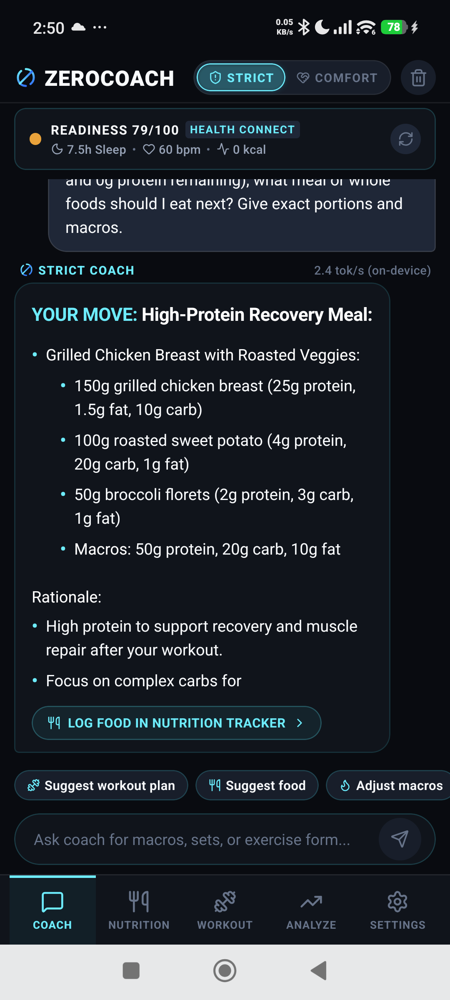
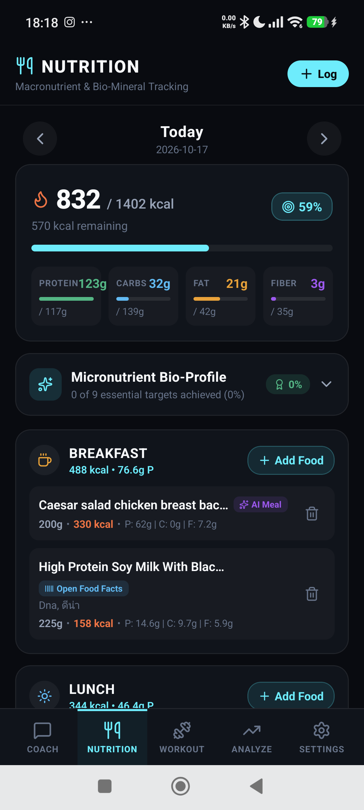
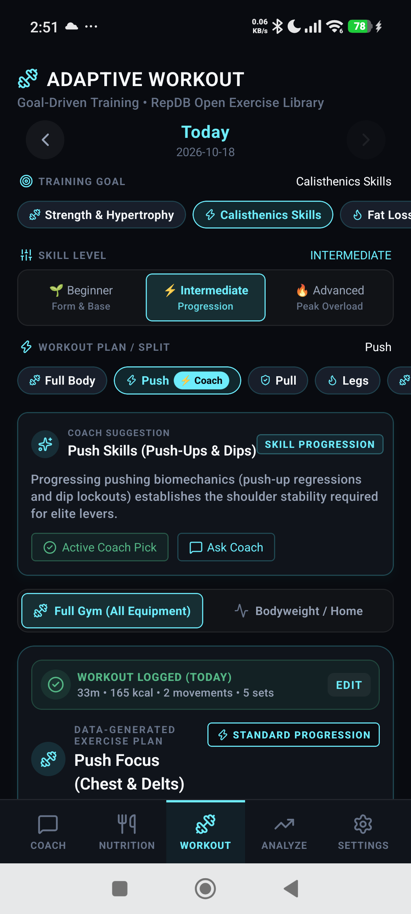
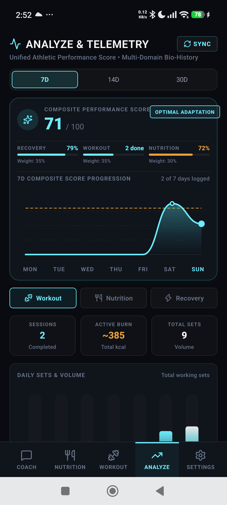
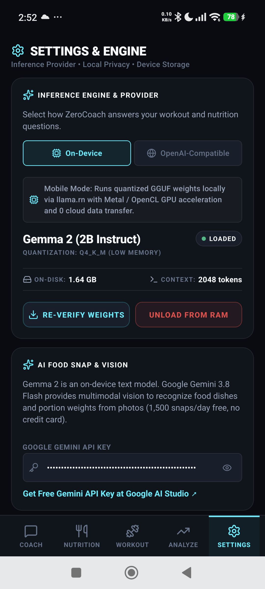

# ZeroCoach

[](https://github.com/ntsd/zerocoach/releases/latest)
[](https://github.com/ntsd/zerocoach/releases/latest/download/ZeroCoach-v1.0.0.apk)
[](LICENSE)

ZeroCoach is an open-source, privacy-first mobile fitness and AI coaching application powered entirely by on-device and local AI models. Built with React Native and Expo, it delivers science-backed workout programming, adaptive nutrition targets, and real-time coaching—with zero cloud latency and absolute data privacy.

---

## 📸 App Preview

| 💬 Coach Chat | 🥗 Nutrition Tracker | 🏋️ Adaptive Workout |
|:---:|:---:|:---:|
|  |  |  |
| **Gemma 2 On-Device Coach**<br>Real-time athletic guidance & dual persona | **Smart Nutrition & Macros**<br>Lab micronutrients & barcode scanning | **Adaptive Workout Hub**<br>RepDB exercises & personalized splits |

<br/>

| 📈 Performance & Trends | ⚙️ On-Device Engine |
|:---:|:---:|
|  |  |
| **Multi-Domain Analytics**<br>Readiness, volume progression & composite score | **Hardware Acceleration**<br>Quantized GGUF execution & local endpoints |

---

## ✨ Key Features

- 📱 **100% On-Device AI Inference**: Runs quantized LLM models (e.g. Gemma 2) locally with hardware acceleration—zero cloud latency, zero API costs, and absolute data privacy.
- 🔌 **OpenAI-Compatible Local Endpoints**: Connect seamlessly to local network LLM runners like Ollama, LM Studio, vLLM, or desktop llama.cpp servers.
- 💬 **Conversational Athletic Coach**: Real-time AI coaching with dual personas (*Strict* vs. *Comfort*), auto-regulating advice based on live recovery metrics and nutrition.
- 🏋️ **Goal-Driven Adaptive Training**: Automatically generates personalized workout splits based on readiness scores, equipment (Gym vs. Bodyweight), and athlete skill level.
- 📚 **RepDB Exercise Library**: Integrated catalog of 643 science-backed exercises with start/peak pose previews, customizable movement swapping, and skipping.
- 🥗 **Smart Nutrition & Macro Tracking**: Dynamic calorie and macronutrient targets with whole food search, barcode scanning, and natural-language composite meal decomposition.
- 📈 **Unified Athletic Analytics**: Multi-domain bio-history tracking recovery, workout volume, and nutrition with composite scoring and SVG trendline charts.
- ⌚ **Universal Wearable & Health Sync**: Direct on-device sync with Android Health Connect and Apple HealthKit to aggregate sleep, HRV, heart rate, and steps across Garmin, Apple Watch, Whoop, Oura, Samsung, and more.
- 🎨 **Privacy-First Obsidian Interface**: Dark-mode glassmorphic aesthetic optimized for fluid mobile interactions and system safe insets.
---

## 🏗️ Architecture & Tech Stack

ZeroCoach is engineered for privacy, speed, and resilient offline execution:

| Layer | Technology |
|---|---|
| **Framework** | [React Native](https://reactnative.dev/) with [Expo](https://expo.dev/) (TypeScript) |
| **On-Device Inference** | [llama.rn](https://github.com/mybigday/llama.rn) (React Native bindings for `llama.cpp`) running quantized GGUF models |
| **Local LLM Providers** | OpenAI-compatible SSE streaming client supporting Ollama, LM Studio, and vLLM |
| **Web Inference Engine** | Automatic deterministic simulation engine when running in browser environments |
| **Exercise Database** | Open Exercise Repository adapted from [RepDB](https://repdb.co) (643 movements with verified CDN pose assets) |
| **Nutrition Databases** | [Open Food Facts](https://world.openfoodfacts.org/) API + Bundled USDA FoodData Central whole foods dataset |
| **State Management** | [Zustand](https://github.com/pmndrs/zustand) with AsyncStorage local persistence |
| **Styling & Design** | Sleek Cyber-Athletic Dark Mode (`#080B10`), HSL accents, and glassmorphic micro-components |
| **Icons** | [Lucide React Native](https://lucide.dev/) |

---

## 📱 App Navigation & Modules

### 1. 💬 Coach (`CoachChatScreen`)
- Real-time conversational AI coaching with live tokens-per-second streaming metrics.
- Formatted response rendering for structured lists, kinetic cues, bold titles, and biomechanical guidance.
- Synchronized with active wearable telemetry (HRV, resting heart rate, sleep duration, calorie burn) and **today's logged nutrition totals & remaining macros**.
- Context-aware coaching chips:
  - *Suggest Food*, *Suggest Workout Plan*, *Adjust Macros*, *Readiness Review*, *Bodyweight Cues*.
  - Deep-link action pills (*"Log Food in Nutrition Tracker"*, *"View Workout & Progressions"*).

### 2. 🥗 Nutrition (`NutritionScreen`)
- **Macro Progress Header**: Real-time calorie gauge, remaining energy budget, and progress bars for Protein, Carbs, Fat, and Dietary Fiber.
- **Micronutrient Bio-Profile Scorecard**: Expandable RDA tracker for Vitamins (A, C, D, B12) and Minerals (Iron, Calcium, Magnesium, Potassium, Sodium limit, Zinc).
- **Meal Sections**: Structured daily tracking across Breakfast, Lunch, Dinner, and Snacks.
- **Log Food Modal**:
  - *Database Search*: Search whole foods (USDA) and packaged products (Open Food Facts).
  - *Barcode Scanner*: Scan barcodes or enter codes with instant OFF product lookup.
  - *Snap / NutriSight Label Scanner*: Dual-mode camera scanner featuring **Open Food Facts NutriSight** (`openfoodfacts/nutrition-extractor` LayoutLMv3 token schema) to extract exact nutrition tables (calories, protein, carbs, fat, fiber, sodium, and serving grams) from packaging labels, alongside multimodal cooked meal plate decomposition.
  - *Portion Review Sheet*: Adjust grams/servings with real-time nutrient recalculation before logging.

### 3. 🏋️ Workout (`ProgressionsScreen`)
- **Training Goal & Skill Level Selectors**: Tailor routines for *Strength*, *Calisthenics*, *Fat Loss*, *Cardio*, or *Longevity* across *Beginner*, *Intermediate*, or *Advanced* tiers.
- **Workout Split Hub**: Select *Full Body*, *Push*, *Pull*, *Legs*, *Upper*, *Lower*, *Core & Mobility*, *Calisthenics Skills*, or *Cardio Engine*.
- **Coach Suggestion Banner**: 1-tap apply for CNS readiness-tailored split recommendations.
- **Adaptive Daily Exercise Plan**:
  - Complete routine with dynamic warmups, primary compound lifts, secondary volume, and cooldowns.
  - RepDB movement specifications: target sets/reps, rest intervals, equipment, target muscles, and MET burn.
  - **Skip / Restore**: Skip exercises dynamically without distorting completion progress.
  - **Swap Movement**: Instant replacement with any exercise targeting the same muscle group.
  - **Add Skill / Exercise from RepDB**: Search and select from 643 exercises (with quick filters for Pull-ups, Dips, Squats, etc.).
  - **Kinetic Pose Previews**: Exercise detail modal showing start and peak pose images.

### 4. 📈 Analyze & Telemetry (`AnalyzeScreen`)
- **Unified Athletic Performance Score**: Daily 0–100 composite score combining Central Nervous System (CNS) recovery (35%), workout adherence (35%), and nutrition target accuracy (30%).
- **Interactive Multi-Domain Bio-History**: Filter across 7-day, 14-day, and 30-day time ranges with smooth SVG trendline charts and volume bar charts.
- **Dynamic CNS Readiness Gauge**: Evaluates recovery status based on HRV, resting heart rate, sleep duration, and deep sleep architecture.
- **Native OS Health Hub Bridge**: Connects locally to Android Health Connect or Apple HealthKit to read biometrics from paired wearables (Garmin, Apple Watch, Samsung, Whoop, Oura, Pixel, Xiaomi, Strava) with zero remote API latency.
- **Domain Breakdown**: Dedicated trend tabs for *Workout* (sessions, active burn, set volume), *Nutrition* (calorie compliance, macro balance), and *Recovery* (sleep quality, HRV).
- **Smart Scale Auto-Sync**: Automatically updates athlete body weight and recalibrates daily nutrition targets whenever a new weigh-in is detected.

### 5. ⚙️ Settings & Engine (`ModelManagerScreen`)
- **Inference Provider Configuration**:
  - `On-Device`: Direct quantized GGUF execution via `llama.rn` on iOS/Android, with automatic browser fallback for web previews.
  - `OpenAI-Compatible`: Connect to local desktop or LAN endpoints (e.g., `http://192.168.1.100:11434/v1` for Ollama).
- **Local Storage Management**: One-tap clearance for chat transcripts or full athlete biometric data wipe.

---

## 🚀 Getting Started

### Prerequisites

- **Node.js**: >= 18.0.0
- **npm** or **yarn**
- **Mobile Development**: Xcode (iOS) or Android Studio / Android SDK (Android)
- **Web Development**: Any modern Chromium or WebKit browser

### Installation

```bash
# 1. Clone the repository
git clone https://github.com/ntsd/zerocoach.git
cd zerocoach

# 2. Install dependencies
npm install
```

### Running Locally

```bash
# Start the Expo development server
npm start

# Run in Web browser (Instant preview with automated web engine)
npm run web

# Run on Android (Physical device or emulator)
npm run android

# Run on iOS (Physical device or simulator - macOS only)
npm run ios
```

### 📦 Standalone Android APK (No Play Store Required)

Pre-built signed release APKs are available on the [**GitHub Releases**](https://github.com/ntsd/zerocoach/releases) page for immediate download.

To build the APK locally from source:

```bash
# Build standalone release APK (bundles JS, assets, and native llama.rn libraries)
npm run build:apk

# Generated APK output:
# android/app/build/outputs/apk/release/app-release.apk

# Sideload directly to a connected Android device:
adb install -r android/app/build/outputs/apk/release/app-release.apk
```

### ⚡ Over-The-Air (OTA) Updates (iOS & Android)

ZeroCoach supports Over-The-Air (OTA) hotfixes via `expo-updates`. Bug fixes, coach prompt refinements, UI improvements, and calculation updates can be deployed directly to existing Android and iOS installs without rebuilding binaries:

```bash
# Push an instant OTA hotfix to both Android and iOS installs
npm run update:publish -- --message "Fix macro calculation and prompt tuning"
```

Users can also tap **"CHECK FOR OTA UPDATES"** anytime in **Settings → Over-The-Air (OTA) Hotfix Channel** to check for and apply updates on-demand.

---

## 🧠 Model Configuration & GGUF Support

When using on-device inference on physical devices:
1. Supported model formats: Quantized `.gguf` files (recommended: `Q4_K_M` or `Q4_0` 2B-3B parameter models such as Google Gemma 2 2B, Qwen 2.5 1.5B/3B, or Llama 3.2 1B/3B).
2. For local network inference, configure your desktop runner (e.g. `ollama run gemma2:2b` or LM Studio local server) and enter your local network IP in **Settings → OpenAI-Compatible Provider**.

---

## 📄 License

ZeroCoach is released under the **Apache License 2.0**. See the [LICENSE](LICENSE) file for details.
