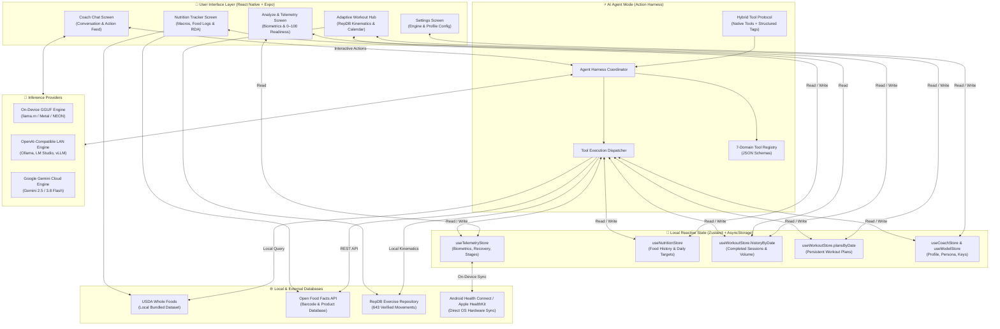
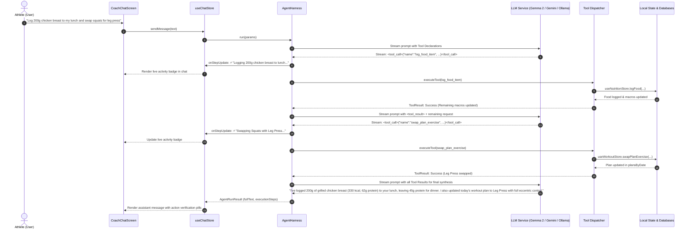

# ZeroCoach System Architecture

ZeroCoach is an open-source, privacy-first mobile fitness and sports science coaching application engineered to run entirely on-device and on local infrastructure.

This document specifies the system architecture of ZeroCoach, detailing the **Symmetric App UI and AI Agent Access Model**, the **Agent Harness Execution Lifecycle**, the **7 Core Architectural Domains**, and **Token-Saving Design Patterns**.

---

## 🏛️ High-Level System Architecture

ZeroCoach establishes **100% symmetric read/write parity** between the direct Mobile App User Interface and the conversational AI Coach. Any action an athlete can perform in the UI (logging food, swapping exercises, adjusting macro targets, viewing biometrics) can also be performed conversationally by the AI Agent via its **Action Harness**, and vice versa.

---

## 📊 7-Domain Symmetric Access Parity Matrix

Every domain exposes symmetric capabilities across the mobile interface and the agent harness:

| Domain | App UI Access | AI Agent Harness Access | Primary Store / Service |
|---|---|---|---|
| **1. Fitness Telemetry** | View live Readiness (0–100), HRV, resting HR, sleep architecture, steps, and sync wearables | **Read**: `get_telemetry_metrics()` **Action**: `sync_fitness_telemetry()` | `useTelemetryStore`, `fitnessBridgeService` |
| **2. Food History** | Browse meal logs across calendar dates, log foods to meal sections, delete items, update macro targets | **Read**: `get_food_history()` **Write**: `log_food_item()`, `delete_logged_food()`, `update_daily_macro_targets()` | `useNutritionStore` (`logsByDate`) |
| **3. Food Database** | Search whole foods, query branded packaged products, scan barcodes | **Read**: `search_food_database()`, `get_food_details()` | `openFoodFactsService`, bundled USDA dataset |
| **4. Workout History** | Review past workout sessions, completed sets, movement counts, and volume | **Read**: `get_workout_history()` **Write**: `log_completed_workout()` | `useWorkoutStore` (`historyByDate`) |
| **5. Workout Plan** | View adaptive daily splits, swap movements, skip exercises, schedule future routines | **Read**: `get_workout_plan()` **Write**: `update_workout_plan()`, `swap_plan_exercise()` | `useWorkoutStore` (`plansByDate`) |
| **6. Workout Database (RepDB)** | Browse 643 movements, filter by muscle/equipment, view start/peak pose images & kinetic cues | **Read**: `search_exercises()`, `get_exercise_details()` | `exerciseRepository` (`data/exercises.json`) |
| **7. ZeroCoach Settings** | Update athlete goals, weight, height, equipment preference, skill level, language | **Read**: `get_user_settings()` **Write**: `update_user_settings()` | `useCoachStore`, `useModelStore` |

---

## ⚡ Agent Harness Execution Lifecycle

The Agent Harness acts as an autonomous intermediary between the athlete, the LLM inference engine, and the local reactive state:

### 1. Always-On Autonomous Execution
- No mode toggles or modal interruptions are needed.
- When the athlete asks questions or requests changes, the Agent Harness automatically detects whether tool operations are required.
- Write actions immediately update local state, ensuring the UI reflects modifications without page refreshes.

### 2. Live Activity Status Pills
- While tools are being executed, the UI displays real-time execution pills (`⚡ HARNESS: LOGGING 200G CHICKEN BREAST...`).
- When generation completes, verification pills (`⚡ Logged 200g chicken breast (330 kcal, 62g protein) to lunch`) are attached directly beneath the coach message for transparency.

### 3. Hybrid Multi-Engine Tool Calling Protocol
ZeroCoach runs on diverse hardware profiles with three distinct inference engines:
1. **On-Device GGUF (`llama.rn`)**: Runs quantized models (e.g. Gemma 2 2B/9B, SmolLM) locally on Apple Metal (iOS) and ARM64 NEON (Android). The Agent Harness employs structured `<tool_call>{"name": ..., "arguments": ...}</tool_call>` tag formatting with strict JSON schema definitions in the compact system prompt.
2. **OpenAI-Compatible Local Runners**: Streams from Ollama, LM Studio, or vLLM running on local networks.
3. **Google Gemini API**: Native cloud streaming via Gemini 2.5/3.8 Flash for high-speed multimodal scenarios.

---

## 🎯 Token Optimization Strategy (Saving LLM Tokens)

On-device inference and mobile context windows require conservative token budgets. ZeroCoach implements three architectural optimizations to minimize prompt bloat:

1. **On-Demand Tool Retrieval vs. Context Dumping**:
   - Rather than dumping the entire 7-day workout routine, 643 exercises, and complete food diaries into the system prompt, the baseline prompt contains only high-level summary metrics.
   - When the athlete inquires about workout plans or food items, the LLM calls `get_workout_plan(date)` or `search_food_database(query)` on demand, fetching only the specific payload needed for that turn.
2. **Compact ReAct Schemas**:
   - Tool declarations use concise function signatures (`tool_name(param1, param2): description`) rather than voluminous multi-kilobyte JSON schema definitions on quantized on-device models.
3. **Context Window Compression**:
   - Older assistant conversation turns are truncated to essential highlights (<= 240 chars) to prevent quadratic prefill latency on mobile GPUs.

---

## 🔒 Security & Privacy Sandbox

1. **Local-First Sandboxing**:
   - All athlete biometrics, workout logs, nutrition diaries, and custom plans remain strictly inside the device's sandbox (`AsyncStorage`).
   - No biometric data, personal health records, or chat transcripts are ever transmitted to third-party tracking servers.
2. **Ephemeral Inference**:
   - When using on-device models (`llama.rn`), inference runs entirely in local RAM and GPU shaders with zero network requests.
3. **Hardware Health Isolation**:
   - Connections to Android Health Connect and Apple HealthKit operate via OS-sanctioned permissions and read local device health caches without cloud intermediaries.

