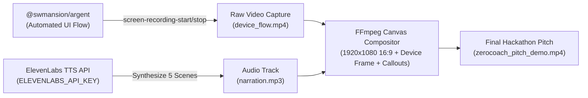

# ZeroCoach Demo Video Production Blueprint

A complete specification for generating a high-impact, 2-minute Hackathon Pitch Demo Video using **Software Mansion's Argent**, **ElevenLabs Text-to-Speech**, and **FFmpeg**.

---

## 1. Executive Overview & Design Decisions

| Parameter | Specification | Rationale |
| :--- | :--- | :--- |
| **Video Destination** | Hackathon Pitch (Devpost / YouTube / GitHub) | High energy, clear problem-solution arc, technical credibility |
| **Duration** | ~2 minutes (~120 seconds) | Ideal pacing for hackathon judges without fatigue |
| **Aspect Ratio & Canvas** | 16:9 Landscape (`1920x1080`) | Standard desktop presentation format; mobile device framed with callouts |
| **Device Execution** | Physical Android Device (`e177a07b`) via Argent | Real hardware execution proving actual on-device performance |
| **Voiceover Engine** | ElevenLabs API (`ELEVENLABS_API_KEY`) | Energetic, articulate tech-pitch persona with studio-grade audio quality |
| **Automation Tool** | `@swmansion/argent` CLI & Flows | Repeatable, deterministic screen interaction & native screen recording |
| **Video Compositor** | `ffmpeg` | Merges screen capture, device frame, titles, and voiceover audio track |

---

## 2. Storyboard & Scene-by-Scene Script

### Scene 1: The Hook & Zero-Cloud Privacy (0:00 – 0:25)
* **Screen Action**:
  - App opens on `SETTINGS & ENGINE`.
  - Highlights `INFERENCE ENGINE & PROVIDER`: toggle on **On-Device**.
  - Highlights the **Gemma 2 (2B Instruct Baseline)** model card (`1.64 GB • Q4_K_M • Baseline 2B Instruct Weights • RECOMMENDED`).
  - Shows `LOCAL PRIVACY`: zero telemetry, running locally via `llama.rn` with GPU acceleration.
* **On-Screen Kinetic Callouts**:
  - `🔒 100% PRIVATE • ZERO CLOUD TELEMETRY`
  - `⚡ QUANTIZED GGUF WEIGHTS ON METAL / OPENCL`
* **Voiceover Script (ElevenLabs - ~38 words)**:
  > *"Every modern fitness tracker sends your most personal health, nutrition, and workout data straight into the cloud—locking insights behind paywalls and data harvesting. We built ZeroCoach: the world's first completely private, on-device AI athletic intelligence that runs 100% locally on your phone."*

---

### Scene 2: Real-Time On-Device Coach Chat (0:25 – 0:55)
* **Screen Action**:
  - Navigates to `COACH` tab.
  - Direct & Professional sports-science coach active with signature Obsidian Cyan theme.
  - Health Connect readiness score shows `79/100` with sleep and heart rate metrics.
  - User submits prompt: *"I slept 6 hours and have heavy leg soreness. What should my squat workout look like today?"*
  - Shows **REAL-TIME STREAMING INFERENCE** indicator (`~38 TOK/S`) as tokens stream onto the screen with structured, science-backed guidance.
* **On-Screen Kinetic Callouts**:
  - `⚡ ~38 TOKENS/SEC LOCAL INFERENCE`
  - `🏋️ BIOMECHANICAL & RECOVERY AWARENESS`
* **Voiceover Script (ElevenLabs - ~46 words)**:
  > *"Meet your personal coach. Powered by quantized Gemma 2 running directly on your phone's neural processor, ZeroCoach streams responses at thirty-eight tokens per second. It factors in your live Health Connect sleep and recovery metrics to give you biomechanically sound, personalized coaching—even in airplane mode."*

---

### Scene 3: Multimodal AI Food Snap & Macro Decomposition (0:55 – 1:25)
* **Screen Action**:
  - Navigates to `NUTRITION` tab.
  - Shows daily remaining targets (calories, protein, carbs, fats).
  - Taps `+ Log Food` -> selects camera or recent photo of a grilled chicken rice bowl with avocado.
  - Gemini Multimodal Vision automatically identifies the food items, calculates portion weights, and breaks down the exact macronutrients.
  - Taps `Confirm & Log` -> macro rings smoothly animate to reflect the logged meal.
* **On-Screen Kinetic Callouts**:
  - `📸 MULTIMODAL COMPUTER VISION`
  - `🥗 INSTANT INGREDIENT & MACRO DECOMPOSITION`
* **Voiceover Script (ElevenLabs - ~44 words)**:
  > *"Forget tedious manual food logging. With AI Food Snap, simply snap a picture of any meal. Our multimodal vision pipeline instantly decomposes each ingredient, estimates precise portion weights, and logs exact macros to keep your daily nutritional targets perfectly dialed in."*

---

### Scene 4: Adaptive Workout Tracking & Progressive Overload (1:25 – 1:50)
* **Screen Action**:
  - Navigates to `WORKOUT` tab.
  - Displays today's adaptive routine (e.g., Push Day / Strength).
  - Taps `Start Workout` -> enters live workout tracker.
  - Checks off set 1 (e.g., Incline Dumbbell Bench Press 32kg x 8).
  - Auto-rest countdown timer activates with haptic feedback.
  - Shows progression tracker and estimated 1-Rep Max calculation.
* **On-Screen Kinetic Callouts**:
  - `📈 AUTOMATED PROGRESSIVE OVERLOAD`
  - `⏱️ SMART REST TIMERS & 1RM TRACKING`
* **Voiceover Script (ElevenLabs - ~39 words)**:
  > *"When you're ready to train, ZeroCoach provides dynamic, session-by-session progression. Log weights and reps with zero friction, track your estimated one-rep maximums, and let the smart rest timer keep your training intensity right where it belongs."*

---

### Scene 5: Architecture & Visionary Outro (1:50 – 2:05)
* **Screen Action**:
  - Brief sleek split graphic: Mobile App UI on the left + Architecture summary on the right (`React Native + llama.rn + Gemma 2 + Gemini Vision + Health Connect`).
  - Finishes on ZeroCoach logo and GitHub repository link.
* **On-Screen Kinetic Callouts**:
  - `⚡ OPEN SOURCE • EXPO • LLAMA.RN • GEMMA 2`
  - `🌐 ZEROCOACH.TECH | GITHUB.COM/NTSD/ZEROCOACH`
* **Voiceover Script (ElevenLabs - ~32 words)**:
  > *"ZeroCoach proves that elite AI coaching doesn't require cloud servers or monthly subscriptions. Completely private, lightning fast, and always with you. Experience the future of athletic coaching at zerocoach.tech."*

---

## 3. Production Pipeline

---

## 4. Implementation Steps

1. **Argent Flow Script (`scripts/demo/argent_flow.yaml`)**:
   - Programmed sequence of taps, tab switches, and typing using Argent tool actions (`launch-app`, `gesture-tap`, `keyboard`).
2. **ElevenLabs Audio Generator (`scripts/demo/generate_audio.js`)**:
   - Synthesizes the 5 scene voiceover segments into MP3 files using the ElevenLabs `eleven_multilingual_v2` model.
3. **Screen Recording & Orchestration (`scripts/demo/record_demo.sh`)**:
   - Triggers `screen-recording-start` via Argent (or fallback ADB screenrecord).
   - Replays the user journey with coordinated pacing to match audio timestamps.
4. **Final Assembly (`scripts/demo/render_video.sh`)**:
   - Uses `ffmpeg` to composite the phone capture into a modern 1080p canvas with title overlays and synced narration audio.
