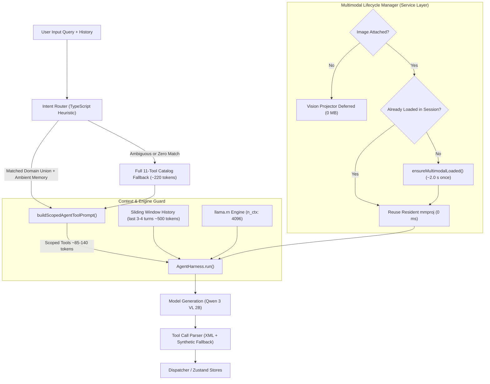

# ZeroCoach Context Optimization & Accuracy Scaling

* **Author:** ntsd
* **Status:** Proposed
* **Date:** 2026-11-06

---

## Overview

ZeroCoach runs an on-device small language model (Qwen 3 VL 2B Instruct via llama.rn) for private sports science, workout programming, and nutrition logging. This design establishes an on-device context management and accuracy architecture. It substantially mitigates tool calling omission, minimizes prompt prefill latency, preserves full 4,096-token context capacity for rich tool data, and recovers 600 MB of native heap by managing multimodal vision projectors on demand with session-scoped caching.

---

## Problem Statement

On-device inference on mobile hardware faces four coupled technical bottlenecks:

1. **Tool Invocation Omission & Format Degradation**: Small 2B models struggle to follow long system instructions when 11 tools (~250 tokens) are declared simultaneously. The model frequently defaults to conversational completions, emits incomplete JSON, or mimics prior assistant confirmation text instead of emitting `<tool_call>` structures.
2. **High Prompt Prefill Latency**: Processing system instructions, athlete profile, active workout plans, telemetry, and 11 tool declarations requires prefilling ~1,100 tokens per turn. On mobile CPUs/NPUs operating at 80–120 tokens/sec, prefill alone introduces a 3–4 second delay before generation starts.
3. **RAM Exhaustion on 6 GB Devices**: Statically allocating base model weights (1.10 GB), eager multimodal vision projector loading (600 MB), a 4,096-token KV cache (~500 MB), and the React Native runtime pushes total memory to ~2.55 GB. On Android devices with 6 GB physical RAM, foreground memory usage exceeding 2.0 GB triggers the OS Low Memory Killer (LMK).
4. **Context Saturation Under Truncated Limits**: Empirical testing with 2,048-token context windows resulted in "context full" runtime exceptions due to the payload size of food database records, athlete telemetry profiles, and vision embeddings. A 4,096-token context ceiling is necessary.

---

## Goals & Non-Goals

### Goals
* **Reliable Tool Calling**: Ensure actionable user requests (memory updates, food logs, workout alterations) reliably trigger tool calls rather than conversational bypasses.
* **Prefill Reduction**: Cut tool declaration token overhead by at least 50% (from ~250 tokens down to <100 tokens), reducing mobile time-to-first-token by 1.5–2.0 seconds.
* **Capacity Preservation**: Retain a 4,096-token context buffer (`n_ctx: 4096`) to prevent context truncation under typical multi-turn chats, database search payloads, and vision tasks within the limit.
* **RAM Containment via Lazy Vision**: Defer vision projector initialization until image payload processing is actively requested, freeing 600 MB of heap during text coaching and keeping memory under ~1.95 GB.
* **Ambient Memory Persistence**: Ensure personal athlete facts, injuries, and preferences are never dropped by tool scoping filters.

### Non-Goals
* **Cloud Offloading**: Offloading execution or routing fallbacks to remote LLM APIs. ZeroCoach remains strictly local-first and offline-capable.
* **Model Parameter Expansion**: Upgrading base weights to 7B+ parameter architectures that cannot fit into mobile RAM limits.
* **Secondary Local LLM Passes**: Introducing an auxiliary on-device model call for intent classification.
* **Context Truncation to 2,048**: Reducing `n_ctx` below 4,096 tokens, which causes context full failures during complex tool returns.

---

## Resolved Architectural Decisions

* **Decision 1 (Cross-Domain Ambiguity & Fallback Policy)**: When user queries touch multiple domains (e.g., *"I did 5 sets of pull-ups and drank 500ml milk"*), the router mounts the natural union of matched domains (~120–140 tokens). If intent classification is ambiguous or matches zero domain keywords, the router falls back to the complete 11-tool catalog (~220 tokens) rather than an arbitrary truncated subset, guaranteeing tools are never starved.
* **Decision 2 (Vision Projector Lifecycle & Memory Policy)**: The 600 MB vision projector adopts **Session-Scoped Lazy Loading**. It remains unloaded at boot (0 MB heap, saving 600 MB for text coaching). It is initialized on demand on the first multimodal turn and remains resident for subsequent turns within the chat session to prevent flash storage read thrashing (1.5–3.0 s reload latency per turn). It is released only when the model itself is unloaded (`useModelStore.unloadModel()`), the chat session is cleared, or on OS backgrounding/memory pressure.

---

## Critical User Journeys (CUJs)

### CUJ 1: Domain-Specific Mutation (Nutrition Logging)
* **Given**: The user has a 6 GB RAM Android device with ZeroCoach active. No image is attached.
* **When**: The user submits *"Log 200 grams of grilled chicken breast for lunch"*.
* **Then**: The intent router identifies `food_history` within <1 ms. The harness injects only `food_history` tools plus ambient memory tools into the prompt (<90 tokens). The model prefill finishes in <1.2 seconds, emits `<tool_call>{"name": "log_food_item", ...}</tool_call>`, executes the database write, and returns a verified confirmation.

### CUJ 2: Contextual Fact Capture During Training Query
* **Given**: The user is viewing today's workout plan.
* **When**: The user says *"My left wrist hurts during push-ups, swap it with something else"*.
* **Then**: The intent router flags `workout_plan`, while ambient `memory` tools are retained. The harness mounts workout modification tools alongside the ambient `save_memory` tool. The model emits `save_memory` for the injury limitation and `swap_plan_exercise` for the movement replacement without dropping either action.

### CUJ 3: Full Context Multi-Turn Chat Without Saturation
* **Given**: An ongoing 10-turn coaching dialogue with food database search outputs.
* **When**: Consecutive queries with large nutritional data payloads are processed.
* **Then**: The full 4,096 context capacity accommodates the search payloads without "context full" exceptions. The vision projector remains uninitialized, keeping resident heap at ~1.95 GB.

---

## Proposed Architecture

### Architectural Topology



### Component Details

#### 1. Heuristic Intent Router (`src/services/agent/intentRouter.ts`)
A low-allocation, sub-millisecond classifier that evaluates the incoming user query and previous conversation turns:
* **Canonical Domain Mapping**: Strictly maps to existing `DomainName` types from `src/services/agent/types.ts`:
  * `food_history`: `['calories', 'protein', 'food', 'meal', 'lunch', 'breakfast', 'dinner', 'snack', 'ate', 'eaten', 'logged', 'กิน', 'มื้อ', 'อาหาร']`
  * `food_database`: `['search food', 'nutrition lookup', 'calories in', 'how much protein', 'หาอาหาร', 'แคลอรี่']`
  * `workout_plan`: `['workout', 'exercise', 'routine', 'sets', 'reps', 'swap', 'schedule', 'rest day', 'โปรแกรม', 'ตารางซ้อม', 'เปลี่ยนท่า']`
  * `workout_history`: `['completed workout', 'finished set', 'logged workout', 'lifted', 'ซ้อมเสร็จ', 'ยกได้']`
  * `workout_database`: `['search exercise', 'technique', 'how to perform', 'form cue', 'ค้นหาท่า', 'วิธีเล่น']`
  * `telemetry`: `['readiness', 'hrv', 'sleep', 'recovery', 'fatigue', 'soreness', 'ความพร้อม', 'การนอน', 'ฟื้นฟู']`
  * `settings`: `['weight', 'target', 'calories goal', 'macro goal', 'profile', 'น้ำหนัก', 'เป้าหมาย']`
* **Ambient Memory Invariant**: The `memory` domain (`save_memory`, `remove_memory`) is **never filtered out**. It is declared unconditionally in all prompts to guarantee that athlete health disclosures, injuries, and preferences can always be captured.
* **Multi-Turn Context Inheritance**: If the current user message contains action verbs or anaphoric pronouns (e.g., *"Log it"*, *"Swap that"*, *"Yes please"*, *"บันทึกเลย"*, *"เปลี่ยนอันนี้"*) but lacks explicit domain keywords, the router inherits the active domain of the immediate preceding turn.
* **Natural Union & Safe Full Fallback**: If multiple domains match, the router mounts the natural union of all matched domains (~120–140 tokens). If zero domains match (casual chat) or classification is ambiguous, it falls back to the full 11-tool catalog (~220 tokens) to guarantee zero tool starvation.

#### 2. Scoped Tool Prompt Builder (`src/services/agent/agentHarness.ts`)
Refactors the static `buildAgentToolPrompt()` into `buildScopedAgentToolPrompt(activeDomains: DomainName[])`:
* Filters a compact lookup table of tool definitions (~10–15 tokens per tool) down to ambient memory tools + matched domain tools (~75–95 tokens for single domain, ~120–140 tokens for unions), rather than dumping serialized JSON schemas.
* Incorporates concrete single-line `<tool_call>` syntax examples corresponding to active domains.
* Owned and invoked directly at the entry point of `AgentHarness.run`.

#### 3. Engine Context Capacity & KV Cache Prefix Dynamics (`src/services/llm/llamaRNEngine.ts`)
* Retains existing codebase configuration `n_ctx: 4096` in `initLlama` to provide full headroom for USDA database entries, recipe expansions, and vision embeddings.
* Context arithmetic for 4,096 tokens:
  * System prompt & athlete context: ~350 tokens.
  * Scoped tool declarations: ~85–140 tokens.
  * Chat history (3–4 compressed turns): ~500 tokens.
  * Vision image embedding buffer (when image attached): ~576 tokens.
  * Rich tool result data buffer (e.g., USDA food search): ~800–1,200 tokens.
  * Output generation headroom: ~1,000 tokens.
  * Total worst-case peak: ~3,300–3,750 tokens, well within 4,096 tokens.
* **KV Cache Dynamics**: While mutating tool declarations on domain switches invalidates the KV cache prefix at token 0, the compact sliding history window (~500 tokens) requires only ~40–50 ms to re-prefill on mobile processors, making dynamic prompt scoping a net win for tool reliability.

#### 4. Multimodal Vision Projector Lazy Loading (`src/store/useModelStore.ts` & `src/services/llm/llmService.ts`)
* Removes automatic `llmService.initMultimodal(...)` from both `loadModel()` and `autoInitOnDeviceModel()` sequences.
* Updates `ModelState` in `src/types/model.ts` to add `isVisionProjectorLoaded: boolean`.
* Introduces `ensureVisionProjectorLoaded()` in `useModelStore`:
  * Checks if already loaded; returns immediately if true.
  * Resolves `mmprojPath` from downloaded assets and awaits `llmService.ensureMultimodalLoaded(mmprojPath)`.
  * Sets `isVisionProjectorLoaded: true`.
* Encapsulated strictly in the service layer (`useChatStore`, `photoMealAnalyzer`); `CoachChatScreen.tsx` does not manage native heap lifecycles.
* Released upon `unloadModel()`, chat reset, or app backgrounding.

### Memory Footprint Accounting (6 GB Device Target)

| Component | Baseline Footprint | Optimized Footprint | Savings |
| :--- | :--- | :--- | :--- |
| **Qwen 3 VL 2B Base GGUF** | 1,100 MB | 1,100 MB | 0 MB |
| **Multimodal Vision Projector** | 600 MB (eager) | 0 MB (text chat deferred) | -600 MB |
| **llama.rn KV Cache** | 500 MB (`n_ctx: 4096`) | 500 MB (`n_ctx: 4096`) | 0 MB (Retains Capacity) |
| **React Native & Hermes Runtime** | 350 MB | 350 MB | 0 MB |
| **Total Resident Heap** | **2,550 MB** (High LMK Risk) | **1,950 MB** (Below 2.0 GB LMK Threshold) | **-600 MB (24%)** |

---

## Risks & Limits

1. **Heuristic Router Misclassification & False Negatives**:
   * *Risk*: The user submits an unusual phrasing that fails keyword matching, omitting a tool the model needed to call.
   * *Mitigation*: The Ambient Memory Invariant guarantees memory tools are never omitted. For other domains, if zero keywords match or confidence is ambiguous, the router falls back to the full 11-tool catalog (~220 tokens).
2. **Flash Storage Read Latency on First Image Turn**:
   * *Risk*: When a user sends their first photo meal query, loading the 600 MB `mmproj` from flash storage adds a one-time 1.5–2.5 second delay before inference starts.
   * *Mitigation*: Session-scoped lazy loading ensures this delay occurs only once per session. Subsequent queries or follow-up corrections reuse the resident projector with zero latency.
3. **KV Cache Prefix Invalidation Across Domain Switches**:
   * *Risk*: Switching between unrelated domains (e.g., nutrition -> workout) changes the tool block in the system prompt, invalidating the cached KV prefix from token 0.
   * *Mitigation*: Because ZeroCoach bounds chat history to 3–4 compressed turns (~500 tokens), re-prefilling history takes <50 ms on mobile NPUs/CPUs, which is imperceptible to the user.
4. **Multilingual Query Gaps**:
   * *Risk*: Athletes chatting in Thai might use vocabulary not captured by English-only regexes.
   * *Mitigation*: Token dictionaries explicitly include both English and Thai vocabulary for all 8 domains.

---

## Alternatives Considered

### Alternative 1: Reducing Context Window to 2,048 Tokens
* **Pros**: Cuts KV cache memory allocation by ~250 MB.
* **Cons**: Causes context overflow errors during active sessions when returning multi-item food search results, extensive workout plans, or multimodal image embeddings.
* **Reason for Rejection**: On-device benchmarks confirmed that 2,048 tokens frequently triggers "context full" exceptions during multi-item food lookups. Preserving 4,096 tokens is strictly required for functional stability.

### Alternative 2: Secondary On-Device LLM Intent Classifier
* **Pros**: Natural language understanding across ambiguous queries without maintaining keyword tables.
* **Cons**: Introduces 1.5–2.5 seconds of additional inference delay per turn and double-buffers model execution on mobile CPUs.
* **Reason for Rejection**: Exceeds target turn latency budgets (adding 1.5–2.5 s) and defeats the prefill acceleration goal. A regex and keyword matcher executes in under 1 millisecond with negligible memory overhead.

### Alternative 3: Eager Multimodal Projector Loading at Startup
* **Pros**: Zero latency when an image is first attached by the user.
* **Cons**: Holds 600 MB in heap permanently even when the user only conducts text-based workout consultations.
* **Reason for Rejection**: More than 90% of user turns are text-only. Carrying the 600 MB projector pushes total app memory to ~2.55 GB, directly provoking OS Low Memory Killer terminations during intensive workout sessions.

### Alternative 4: Universal GBNF Grammar Enforcement on All Turns
* **Pros**: Restricts logits strictly to valid `<tool_call>` syntax, preventing JSON syntax errors.
* **Cons**: Forces the model to generate a tool call even when the user asks an open-ended coaching or educational question, causing synthetic tool hallucinations.
* **Reason for Rejection**: Open-ended conversational queries require free-form natural language generation. GBNF (GGML BNF) grammar enforcement is unsuited for mixed conversational/tool-calling turns without an alternating root grammar.

---

## Detailed Implementation

The implementation is partitioned into three incremental, independently verifiable phases:

```
Phase 1: Intent Routing & Scoped Prompting
├── src/services/agent/types.ts (Verify DomainName compatibility)
├── src/services/agent/intentRouter.ts (CREATE)
├── src/services/agent/agentHarness.ts (MODIFY)
└── src/services/agent/__tests__/intentRouter.test.ts (CREATE)

Phase 2: Engine & Store Multimodal Deferral
├── src/types/model.ts (MODIFY - add isVisionProjectorLoaded & actions)
├── src/store/useModelStore.ts (MODIFY - remove eager init, add lazy actions)
├── src/services/llm/llmService.ts (MODIFY - ensureMultimodalLoaded signature)
└── src/store/__tests__/useModelStore.test.ts (CREATE)

Phase 3: Pipeline Integration & Verification
├── src/store/useChatStore.ts (MODIFY - await ensureVisionProjectorLoaded before vision)
├── src/services/nutrition/photoMealAnalyzer.ts (MODIFY - await ensureVisionProjectorLoaded)
└── End-to-End Verification on Device (VERIFY)
```

### Phase 1: Intent Routing & Scoped Prompting

#### 1.1 `src/services/agent/intentRouter.ts` (CREATE)
* **Rationale**: Implements sub-millisecond, low-allocation classification of user messages into target tool domains.
* **Changes**:
  * Export `classifyUserIntent(query: string, history?: { role: string; content: string }[]): DomainName[]`.
  * Match against bilingual token dictionaries (English + Thai) for `food_history`, `food_database`, `workout_plan`, `workout_history`, `workout_database`, `telemetry`, and `settings`.
  * If query contains action verbs/pronouns without domain keywords, inspect `history` to inherit prior domain.
  * Append `memory` unconditionally (Ambient Memory Invariant).
  * If zero domains match (casual chat) or query is ambiguous, return all domains (Safe Full-Catalog Fallback).

#### 1.2 `src/services/agent/agentHarness.ts` (MODIFY)
* **Rationale**: Refactors monolithic tool injection to dynamically scope prompts based on classified intent.
* **Changes**:
  * Refactor `buildAgentToolPrompt()` into `buildScopedAgentToolPrompt(activeDomains: DomainName[])`.
  * Filter compact tool definition mapping down to the active domains (~75–140 tokens).
  * Invoke `classifyUserIntent(lastUserMessage, params.messages)` at the entry point of `AgentHarness.run`.

#### 1.3 `src/services/agent/__tests__/intentRouter.test.ts` (CREATE)
* **Rationale**: Validates router accuracy, inheritance, and fallback invariants.
* **Test Cases**:
  * Single-domain classification (e.g., *"Log 200g chicken"* -> `food_history`, `memory`).
  * Cross-domain union classification (e.g., *"Log 200g steak and 5 sets pull-ups"* -> `food_history`, `workout_plan`, `memory`).
  * Thai keyword queries (e.g., *"กินอกไก่ 200 กรัม"* -> `food_history`, `memory`).
  * Multi-turn inheritance (Turn 1: nutrition query -> Turn 2: *"Log it"* -> inherits `food_history`, `memory`).
  * Casual chat fallback (e.g., *"Hello coach"* -> returns full domain catalog).
  * Ambient memory preservation across all classifications.

---

### Phase 2: Engine & Store Multimodal Deferral

#### 2.1 `src/types/model.ts` (MODIFY)
* **Rationale**: Adds projector memory residency state and lifecycle action signatures to `ModelState`.
* **Changes**:
  * Add `isVisionProjectorLoaded: boolean` to `ModelState`.
  * Add `ensureVisionProjectorLoaded: () => Promise<boolean>` to `ModelState`.
  * Add `unloadVisionProjector: () => Promise<void>` to `ModelState`.

#### 2.2 `src/store/useModelStore.ts` (MODIFY)
* **Rationale**: Eliminates eager startup loading in both initialization pathways and exposes lazy lifecycle actions.
* **Changes**:
  * In `loadModel()`, remove eager invocation of `llmService.initMultimodal(...)`.
  * In `autoInitOnDeviceModel()`, remove eager invocation of `llmService.initMultimodal(...)`.
  * Implement `ensureVisionProjectorLoaded()`: returns `true` if already loaded; otherwise calls `llmService.ensureMultimodalLoaded(mmprojPath)` and sets `isVisionProjectorLoaded: true`.
  * Implement `unloadVisionProjector()`: calls `llmService.releaseMultimodal()` and sets `isVisionProjectorLoaded: false`.
  * In `unloadModel()`, call `unloadVisionProjector()`.

#### 2.3 `src/services/llm/llmService.ts` (MODIFY)
* **Rationale**: Standardizes multimodal initialization and release across engine providers.
* **Changes**:
  * Expose `ensureMultimodalLoaded(mmprojPath?: string): Promise<boolean>`.
  * Expose `releaseMultimodal(): Promise<void>`.

#### 2.4 `src/store/__tests__/useModelStore.test.ts` (CREATE)
* **Rationale**: Verifies deferred initialization and session-scoped lifecycle.
* **Test Cases**:
  * `loadModel()` does not call `initMultimodal`.
  * `autoInitOnDeviceModel()` does not call `initMultimodal`.
  * First call to `ensureVisionProjectorLoaded()` invokes engine initialization and sets `isVisionProjectorLoaded = true`.
  * Subsequent calls to `ensureVisionProjectorLoaded()` return immediately without re-initializing.
  * `unloadModel()` releases multimodal context and resets `isVisionProjectorLoaded = false`.

---

### Phase 3: Pipeline Integration & Verification

#### 3.1 `src/store/useChatStore.ts` (MODIFY)
* **Rationale**: Ensures vision projector is loaded prior to image analysis or vision inference turns.
* **Changes**:
  * In `sendMessage()`, before `analyzeMealPhoto` or `AgentHarness.run()`, if `imageUri` is attached and engine is `on_device`, await `useModelStore.getState().ensureVisionProjectorLoaded()`.

#### 3.2 `src/services/nutrition/photoMealAnalyzer.ts` (MODIFY)
* **Rationale**: Guarantees projector availability during standalone meal photo analysis.
* **Changes**:
  * Prepend photo analysis calls with `await useModelStore.getState().ensureVisionProjectorLoaded()`.
  * Remove speculative per-turn unloading.

---

### Test Plan & Verification

1. **Unit Verification (`npm test`)**:
   * Execute `intentRouter.test.ts` covering all single-domain, cross-domain, Thai, and fallback cases.
   * Execute `useModelStore.test.ts` verifying deferred loading and state flags.
2. **Memory Verification via ADB (`adb shell run-as tech.zerocoach dumpsys meminfo`)**:
   * Launch ZeroCoach on connected 6 GB Android test device (`e177a07b`).
   * Perform text coaching queries: verify native resident heap remains under **1.95 GB** (projector unloaded).
   * Submit meal photo: verify projector loads to resident heap (~2.55 GB) and remains stable without OS LMK termination.
3. **Accuracy Verification on Device**:
   * Verify *"Log 200g steak"* triggers `log_food_item` tool call deterministically.
   * Verify *"My wrist hurts"* triggers `save_memory` for injury limitation.
   * Verify casual chat (*"Tell me a joke"*) returns natural language without tool hallucination.
